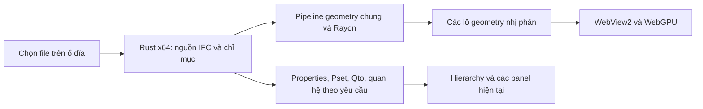

# Chuyển xử lý IFC sang Rust native 64-bit

Ngày khảo sát: 2026-10-03. Checkout: `F:\Steel\VBA\IFC-Lite`, nhánh
`codex/desktop-v10.3.0`. Tag `v10.3.0` trỏ đến
`e79f27342beb01a6f30d9b63c44795ecd118f4de`.

Đây là bản khảo sát kiến trúc trước triển khai. Sau khảo sát, bản EXE UI đã được
đóng gói và một đường native thử nghiệm đã được triển khai. Trạng thái hiện tại,
kiểm chứng và phần còn thiếu được ghi tại `NATIVE-BACKEND-VALIDATION.md`;
các bảng “hiện có/chưa có” bên dưới mô tả thời điểm khảo sát ban đầu.

## Kết luận kiến trúc

Chọn xử lý IFC bằng Rust x64 trong Tauri; giữ giao diện React và renderer WebGPU.
Native backend đọc file từ ổ đĩa, giữ nguồn và chỉ mục, tạo geometry bằng pipeline
Rust chung, rồi cung cấp geometry theo từng lô và dữ liệu BIM theo yêu cầu.
Giới hạn địa chỉ 4 GiB của WASM32 không còn áp dụng cho engine native này.
RAM máy, bộ nhớ WebView2 và GPU vẫn là giới hạn thực tế; không có cam kết RAM
vô hạn hoặc cứ file dưới một dung lượng nào đó là sẽ mở được.

Giới hạn 4 GiB được nói đến là linear memory của mỗi instance WASM32, không phải
một mức trần chung cho mọi web app. Đổi shell sang Rust chưa đủ: shell hiện tại
đã là native x64 nhưng engine IFC vẫn dùng WASM32.

Luồng đề xuất:

## Những gì đã có và những gì còn thiếu

| Phần | Bằng chứng trong checkout | Việc cần làm |
| --- | --- | --- |
| Shell native | `src-tauri/src/main.rs` chỉ gọi `tauri::Builder::default().run(...)` | Đăng ký lệnh và quản lý phiên model |
| Backend geometry | `rust/processing/src/processor/mod.rs` xuất `process_geometry_streaming_with_options_and_bootstrap` | Bọc API chung trong tác vụ nền, có hủy và dọn tài nguyên |
| Bridge frontend | `packages/geometry/src/platform-bridge.ts` có `IPlatformBridge`, hỗ trợ đường dẫn và cache | Chọn bridge thật thay cho alias baseline |
| Baseline WASM | `desktop/wasm-geometry.ts` đặt `preferNative` mặc định thành `false`; `desktop/vite.config.ts` trỏ geometry vào alias này | Bỏ ép WASM khi backend thật đã qua kiểm tra |
| Mở file | `useIfcLoader.ts` gọi `acquireFileBuffer(file)` trước parse | Thêm nguồn native theo đường dẫn/handle trong cùng luồng `loadFile` |
| Dữ liệu BIM | WorkerParser/IfcParser đọc nguồn ở frontend song song với geometry | Tách nguồn khỏi bộ nhớ web; hydrate bảng cần thiết hoặc truy vấn backend |
| Semantic Rust | `apps/server/src/services/data_model/` có Properties, Qto, quan hệ, materials và spatial hierarchy | Tái sử dụng extractor chung; tránh sao chép logic hoặc kéo toàn bộ HTTP server vào shell |
| Store frontend từ native data | `utils/serverDataModel.ts` đã chuyển `DataModel` thành `IfcDataStore`, có `EMPTY_SOURCE_BYTES` | Khảo sát phần nào cần hydrate đầy đủ, phần nào có thể lấy theo yêu cầu |
| Geometry nhị phân | `packages/geometry/src/packed-geometry-decoder.ts` đã đọc các shard nhỏ | Tái sử dụng hoặc mở rộng có version, tránh mảng JSON toàn model |

Trong chính tag `v10.3.0`, root `package.json` ghi 10.3.0 nhưng Rust workspace
ghi 20.3.0 và viewer ghi 4.0.0. Đây là nội dung của tag đã kiểm tra, không phải
checkout bị đổi nhánh. Khi thêm dependency Rust, dùng các crate tại cùng commit
qua `path`; không suy ra version crate từ tên tag rồi tải một bản registry khác.
Baseline hiện có dùng binary npm `@ifc-lite/wasm@10.3.0`; cần kiểm tra parity giữa
binary này và crate native được pin, không mặc định chúng giống nhau về geometry.

## Vì sao chỉ bật preferNative chưa giải quyết mục tiêu

`NativeBridge` cần lệnh Rust tương ứng, hiện shell chưa có lệnh nào. Bật cờ ngay
sẽ gọi lệnh không tồn tại, không biến engine WASM thành native.

Đường gọi theo bytes của bridge hiện dùng `Array.from(content)` và JSON IPC.
Đây là đường không phù hợp với file IFC rất lớn: nguồn tồn tại trong JS, rồi
lại biến thành mảng số và được chuyển qua IPC. Đường theo file path tránh bản
sao nguồn này nhưng viewer hiện chưa sử dụng nó trong luồng nhập IFC thông thường.

Ngay cả khi geometry đã native, `useIfcLoader` hiện vẫn đọc toàn bộ IFC vào
ArrayBuffer/SharedArrayBuffer và dựng datastore frontend. Parser có thể dùng
quét WASM khi API phù hợp tồn tại. Do đó cần hai mốc riêng:

1. Geometry native: bỏ heap WASM32 ở phần tạo mesh.
2. Nạp IFC native hoàn chỉnh: đọc file, giữ nguồn/chỉ mục và semantic ở Rust;
   frontend chỉ nhận dữ liệu cần dùng. Đây mới là đường thích hợp cho mục tiêu
   file rất lớn mà không phụ thuộc buffer nguồn web.

## Hợp đồng bridge cần đối chiếu với source

Guide liệt kê `get_geometry`, `get_geometry_from_path`,
`get_geometry_streaming`, `get_geometry_streaming_from_path` và ba lệnh cache.
Source `NativeBridge` của tag còn có chi tiết bắt buộc:

- `processGeometryStreamingPath` yêu cầu `cacheKey`, không nhận mỗi `path`.
- Nó gọi `get_geometry_streaming_from_path` với `preferPackedShards: true`.
- Nó lấy trạng thái qua `get_native_geometry_cache_stream_status`, rồi lấy shard
  qua `get_native_geometry_cache_packed_shard` với cửa sổ prefetch hữu hạn.
- Event `native-shard-ready` đánh thức việc đọc shard; có nhánh polling dự phòng.
- Bridge còn hỗ trợ `geometry-packed-batch` và `geometry-color-update`.

Vì vậy không chỉ chép tên lệnh từ guide. Phải kiểm tra payload, coordinate frame,
màu/material, diagnostics, progress, phiên model, cache và vòng đời listener.
Một phương án là triển khai nguyên contract này. Phương án khác là bridge desktop
riêng thực hiện `IPlatformBridge`, dùng channel thông báo và shard binary có pull.
Khuyến nghị thứ hai nếu cần giao thức phân biệt rõ từng phiên và backpressure;
đây là đề xuất thiết kế, chưa có benchmark so sánh.

Tauri cung cấp `tauri::ipc::Response` để trả ArrayBuffer thay vì JSON. Channel
cung cấp thứ tự thông điệp cho streaming. Channel không tự chứng minh hàng đợi
có giới hạn; vẫn cần flow control hoặc pull từng shard với giới hạn byte/lô đang
chờ. Những giới hạn truyền tải này không phải một trần dung lượng file IFC.

## Chỉ mục file vượt 4 GiB

Source native đã có phần cần thiết cho offset rộng:

- `EntityIndex` lưu `(usize, usize)` cho vị trí byte.
- `rust/processing/src/processor/entity_index.rs` chỉ chọn index compact khi
  `u32::try_from(content_len).is_ok()`; nguồn rộng hơn dùng hash index chứa usize.
- `native_wide_offsets_keep_the_hash_representation` trong `entity_index_tests.rs`
  kiểm tra span nằm sau `u32::MAX` trên target 64-bit.
- `ColumnarEntityIndex` có offset u32 nên không được ép dùng cho nguồn >4 GiB.

Các đoạn này là bằng chứng source/test có sẵn; test Rust chưa được chạy trong
khảo sát này. Vẫn phải rà mọi cache format, offset truyền qua IPC, giải nén IFCZIP
và extractor downstream trước khi tuyên bố hỗ trợ một file >4 GiB thực tế.
Express ID u32 và chỉ số tam giác u32 không đồng nghĩa byte offset file phải u32.

## So sánh các hướng

| Hướng | Điểm mạnh | Hạn chế với mục tiêu hiện tại |
| --- | --- | --- |
| Rust x64 trong Tauri | Tận dụng pipeline chung, file path, không cần HTTP service | Cần bridge, lifecycle và semantic adapter |
| Rust server local/sidecar | Có sẵn streaming/Parquet và extractor BIM | Thêm process/port/lifecycle; đường upload hiện tại vẫn có nguồn toàn file trong web |
| WASM64 | Có thể mở rộng địa chỉ WASM khi runtime/toolchain hỗ trợ | Không phải thay một cờ; bindings/offset/cache phải đổi, vẫn chịu bộ nhớ browser và truyền dữ liệu |

Chọn Rust x64 trong Tauri cho app desktop. Browser demo tiếp tục có thể dùng
WASM; trình duyệt không tự gọi crate native bằng cách bật `preferNative`.

## Các bước triển khai tiếp theo

1. **Phiên model và nguồn file.** Chọn file native, trả model handle, source hash,
   schema và trạng thái. Rust sở hữu nguồn và chỉ mục; đóng/hủy phiên giải phóng
   chúng. Đường mở file đi qua orchestration `loadFile` hiện tại để không tạo
   pipeline riêng cho multi-model. Nguồn mất/quá cũ/lỗi đọc phải báo rõ.
2. **Geometry native có giới hạn hàng đợi.** Dùng `ifc-lite-processing` tại commit
   đã pin, tạo shard binary; giữ RTC rebase, IFC Z-up → viewer Y-up, transforms,
   màu và diagnostics như pipeline chung. Không gọi GeometryRouter trực tiếp
   để bỏ qua bước rebase và preprocessing.
3. **Semantic.** Tái sử dụng extractor Properties/Pset/Qto/relationships/spatial.
   Bootstrap Hierarchy sớm; lấy thuộc tính theo expressId/model handle và cache.
   Kiểm tra các API hiện đồng bộ của `IfcDataStore` trước khi đổi sang fetch async.
   Search, export, editing, BIM filter và multi-model cũng phải được đánh giá.
4. **Cache và vòng đời.** Version cache theo engine/options, ghi shard hoàn tất
   nguyên tử; không cho job cũ ghi vào model mới. Không phát mesh chéo phiên,
   không để listener hoặc buffer của model đã đóng tồn tại.
5. **Kiểm chứng rồi mới chọn native mặc định.** Trước hết một IFC thật, sau đó
   nhiều model và model lớn. Không âm thầm fallback WASM khi native gặp lỗi
   bộ nhớ, vì điều đó đưa lại đúng giới hạn đang muốn bỏ.

## Điều kiện để tuyên bố đã bỏ giới hạn engine

- Binary backend được biên dịch/đo là x64; IFC desktop không khởi tạo engine
  geometry WASM trên đường native được chọn.
- Nguồn file không đi qua toàn bộ `File.arrayBuffer()`/JSON IPC ở frontend.
- Geometry đối chiếu world-space transformed vertices/bounds, không chỉ đếm
  mesh; kiểm tra voids, materials, IFC units, CRS/RTC và model georeferenced.
- Properties, Pset/Qto, spatial và các quan hệ đúng trên một và nhiều model;
  source-less store không làm export/edit/search mất dữ liệu.
- Đo cold load, first visible geometry, hoàn tất, độ trễ tương tác, RSS của Rust
  lẫn WebView2, hàng đợi shard và GPU. Cache warm không chứng minh cold-load.
- File/offset vượt 4 GiB cần bằng chứng riêng, cùng kiểm tra đóng/hủy/chuyển file,
  lỗi engine và packaged WebView2. Offset giả trong unit test không chứng minh
  một IFC thật >4 GiB đã mở được.

## Nguồn chính thức

- [IFC-Lite desktop bridge](https://ifclite.dev/docs/guide/desktop/)
- [IFC-Lite server](https://ifclite.dev/docs/guide/server/)
- [Tauri: trả ArrayBuffer](https://v2.tauri.app/develop/calling-rust/#returning-array-buffers)
- [Tauri: channels](https://v2.tauri.app/develop/calling-frontend/#channels)
- [V8: giới hạn địa chỉ WASM32](https://v8.dev/blog/4gb-wasm-memory)

Source tại commit pin là căn cứ cho API cụ thể; website có thể phản ánh phiên bản
mới hơn nên phải đối chiếu lại với checkout trước khi triển khai.
